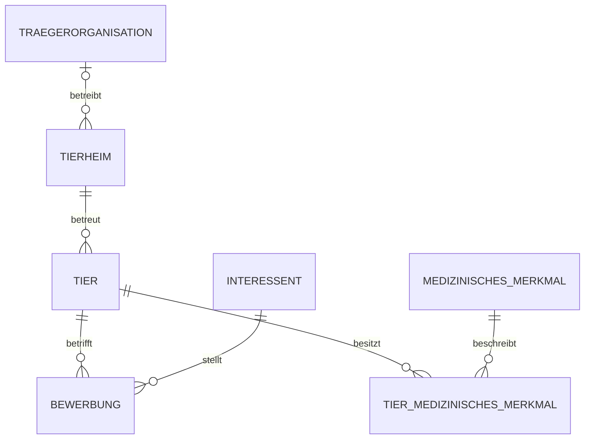

# Datenmodell des Studienprototyps

Dieses Modell beschreibt den erweiterten Entwicklungsstand. main enthaelt ihn erst nach gesonderter Uebernahme des Pull Requests.

## Tabellen und Schluessel

| Tabelle | Primaerschluessel | Wichtige Regeln |
|---|---|---|
| traegerorganisation | organisation_id | kuerzel eindeutig und nicht leer |
| tierheim | tierheim_id | organisation_id optionaler Fremdschluessel; Standortadresse und Kontakte optional |
| tier | tier_id | genau ein Tierheim; Hund oder Katze; definierter Vermittlungsstatus |
| interessent | interessent_id | Haushaltsmerkmale, Erfahrung, Zeit und Budget duerfen unbekannt sein |
| bewerbung | bewerbung_id | genau ein Tier und Interessent; Paar eindeutig; definierte Statuswerte |
| medizinisches_merkmal | merkmal_id | Bezeichnung eindeutig und nicht leer |
| tier_medizinisches_merkmal | tier_id und merkmal_id | eindeutige Zuordnung mit Erfassungsdatum und optionalem Hinweis |

Die m:n-Beziehungen zwischen Tieren und Interessenten sowie Tieren und medizinischen Merkmalen werden durch eigene Tabellen aufgeloest. Bewerbungen sind tatsaechlich erfasste Vorgaenge, nicht automatisch erzeugte Matching-Ergebnisse. Matching wird aus den aktuellen Daten berechnet.

## Views

- matching_v2_details: acht Einzelpruefungen pro verfuegbarem Tier und Interessent.
- matching_v2: Gesamtergebnis sowie Ausschlussgruende und ungeklaerte Kriterien.
- tier_medizin_uebersicht: zugeordnete medizinische Merkmale mit Tier und Standort.
- standort_uebersicht: Standorte mit optionalem Traeger, Kontakten und Tierzahlen.

## Abgrenzung

tierheim bezeichnet technisch den Standort, nicht den uebergeordneten Traeger. Ein Standort darf ohne bekannten Traeger erfasst werden. Keine medizinische Zuordnung bedeutet nicht gesund. Kein bekannter Widerspruch bedeutet bei fehlenden Matching-Angaben nicht passend.

Das Modell speichert keine abgeschlossenen Adoptionsvertraege oder Rueckgaben. Der Status vermittelt ist derzeit nur ein Merkmal am Tier. Bewerbungsstatusuebergaenge sind noch nicht als vollstaendiger Prozess abgesichert. Wiederholte Bewerbungen desselben Paars, Mitarbeiter, Berechtigungskonzept, Standortwechsel-Historie und Benutzeroberflaeche gehoeren nicht zum abgeschlossenen Umfang dieses Prototyps.

Das Diagramm ist ein kompaktes Beziehungsmodell, kein vollstaendiges Chen-Diagramm mit allen Attributen. Eine formale Normalisierungsdokumentation und fachliche Abnahme durch ein Tierheim stehen noch aus.
